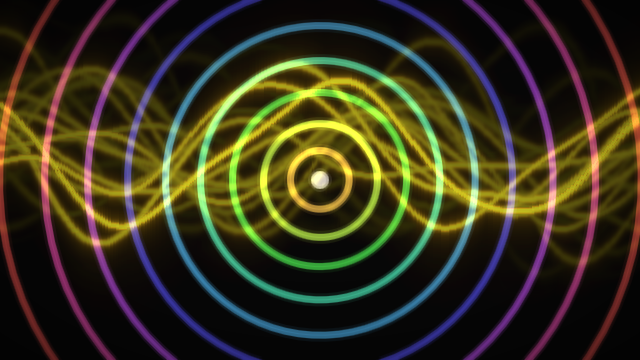

# Visuals

Qure Data can make real-time graphics from a patch, the way Max/MSP's
[Jitter](https://docs.cycling74.com/) or Pd's GEM do. The boxes are the
`gfx.*` objects; the cords between them carry **textures** (drawn purple)
and the frames are made on the GPU at the display's rate.

```
[gfx.audio~ 512]  ←  any signal
 |
[gfx.shader scope]        [gfx.qml Scene.qml]
 |                         |
[gfx.feedback]             |
 |                         |
[gfx.mix 0.5] ─────────────┘
 |
[gfx.shader glow.frag]   ← your own shader, reloaded on save
 |
[gfx.window 640 360]
```

*File ▸ Examples ▸ Audio Visuals* is a complete patch:



## Objects

| Object | Inlets → outlets | What it does |
|---|---|---|
| `gfx.window [w h]` | texture | A window showing what reaches it. Messages: `fullscreen 1/0`, `title …`. Escape leaves fullscreen. |
| `gfx.shader name [p0 p1 …]` | texture, texture → texture | Runs an *effect*: a built-in one by name or a `.frag` file next to the patch. Numbers after the name start `p0`, `p1`…; `p0 0.5` messages change them. |
| `gfx.qml file.qml` | texture → texture, messages | Renders any QML scene: Qt Quick, Shapes, particles, Qt Quick 3D. |
| `gfx.mix [amount]` | texture, texture, amount → texture | Crossfades its inputs (0 = left, 1 = right). |
| `gfx.feedback [decay zoom rotate]` | texture → texture | Video feedback: each frame over the faded, zoomed, turned previous one. Messages `decay`, `zoom`, `rotate`. |
| `gfx.audio~ [samples]` | signal → texture | The latest samples as a texture one pixel high: red is the waveform (0.5 = silence), green the level. |

Built-in effects: `plasma` (a generator), `scope` and `bars` (draw a
`gfx.audio~` texture), `kaleido`, `rgbsplit`, `hue`, `invert`.

A control outlet can feed a texture inlet: messages go to the visual node.
Texture outlets only connect to texture inlets.

## Writing an effect

An effect is one GLSL function. Save it as `something.frag` next to the
patch and create `[gfx.shader something.frag]`:

```glsl
// A vignette over the input, strength in p0.
vec4 effect(vec2 uv) {
    vec4 c = texture(source0, uv);
    return vec4(c.rgb * (1.0 - p0 * length(uv - 0.5)), 1.0);
}
```

Every effect can use:

| | |
|---|---|
| `uv` | position, 0..1, top left is 0,0 |
| `time` | seconds |
| `resolution` | size in pixels |
| `p0` … `p7` | parameters: `[p0 $1(` messages, or numbers after the name |
| `source0`, `source1` | the two texture inlets (`texture(source0, uv)`) |

The file is compiled when the patch opens, for whatever graphics API Qt
uses on the machine (Vulkan, Metal, Direct3D, OpenGL), and **again every
time you save it** – edit a shader while the patch runs. Errors go to the
console, and the last working version keeps running.

## Writing a scene

`[gfx.qml Scene.qml]` loads a QML file next to the patch and renders it into
a texture. The scene's root item may declare:

```qml
import QtQuick

Item {
    property var node     // set by Qure Data
    property Item input0  // the texture inlet, if you want to sample it

    // node.params.<name>: the latest value of every "name value" message
    // the box received, e.g. [level $1( → node.params.level
    Rectangle {
        anchors.centerIn: parent
        width: 100 + (node ? node.params.level || 0 : 0) * 300
        height: width; radius: width / 2
        color: "orange"
    }

    // node.output(1, values) sends a message out of the box's right outlet
    MouseArea { anchors.fill: parent; onClicked: (m) => node.output(1, [m.x, m.y]) }
}
```

Anything Qt Quick can draw works – including Qt Quick 3D when that module
is installed.

## How it works

* **Not on the audio thread.** The engine objects (`src/core/objects/Visuals.cpp`)
  only give the boxes their iolets and pass their messages to the GUI as
  `in <inlet> <selector> <args>`, like QML-only nodes do. `gfx.audio~`
  publishes its samples through a `SnapshotBuffer`, the same lock-free
  path the scope uses. Nothing in the audio engine waits for graphics.
* **The render graph is QML.** `VisualEngine` (`src/app/Visuals.cpp`)
  finds every `gfx.window` and builds the boxes upstream of it as QML items
  (`qml/visuals/*.qml`) in that window. A texture cord becomes a
  `ShaderEffectSource` of the upstream item. Qt's scene graph then does the
  GPU work: one render pass per node, batched, on Qt's render thread, at
  the display's refresh rate. The graph is rebuilt when the patch's
  structure changes; parameter messages only change properties
  (`node.params`, kept even before a window exists).
* **Effects are compiled at runtime.** `EffectCompiler` wraps an effect
  in a full fragment shader (uniforms named after QML properties of the
  `ShaderEffect`), compiles it with `QShaderBaker` to SPIR-V, GLSL, HLSL
  and MSL, caches the result by content, and watches the file.
* **Feedback** uses a recursive `ShaderEffectSource`: the effect reads its
  own previous frame.

### Compared with GEM and Jitter

GEM renders a chain of objects every frame (`[gemhead]` → transforms →
geometry) into an OpenGL window. Jitter is built on n-dimensional
matrices (`jit.matrix`) plus OpenGL objects (`jit.gl.*`). Qure Data's model
is closer to a compositing graph of textures, like Jitter's `jit.gl.slab`
chains. What it adds is QML: a whole animated, interactive scene is one
file and one box.

## Not yet

* Video files and cameras (Qt Multimedia `VideoOutput` into a texture).
* CPU matrices (`jit.matrix`-like processing of arrays as images).
* Spectra – needs an `fft~` object first.
* More than two texture inputs per effect, and multiple render targets.
